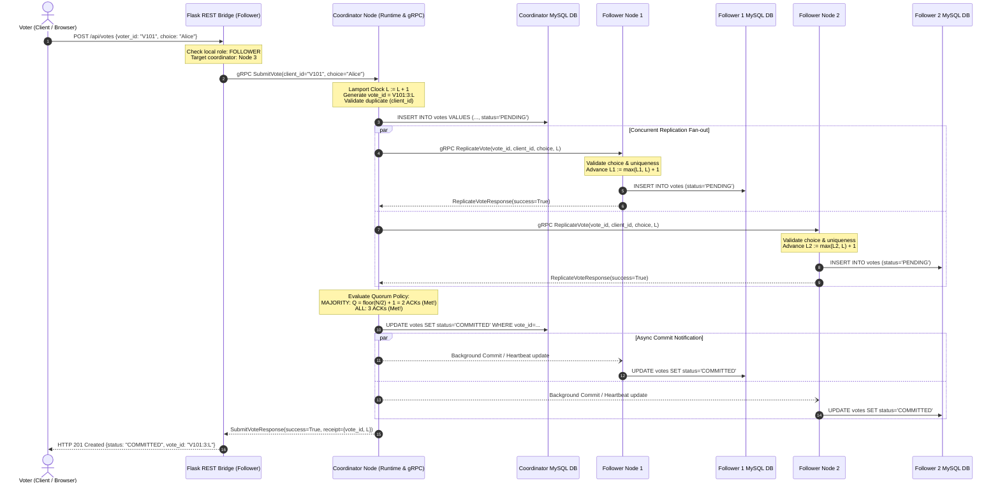
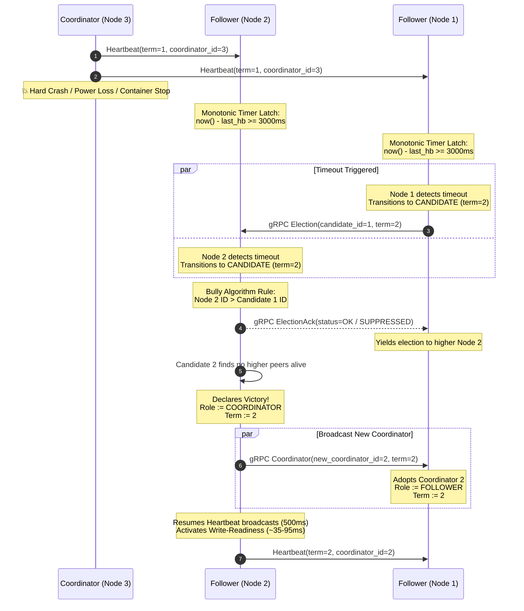
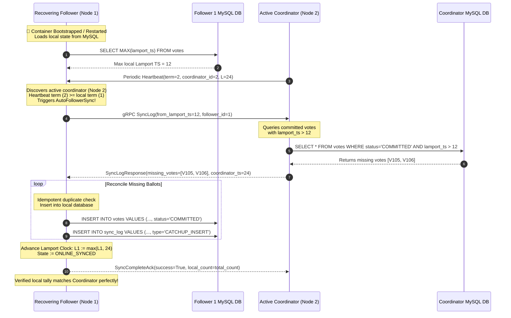
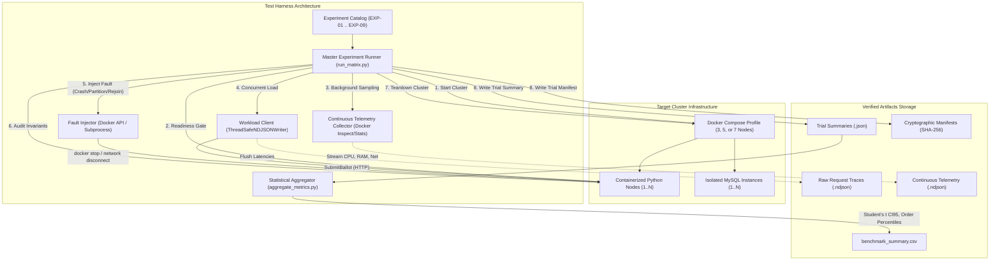

# Distributed Fault-Tolerant Voting System — System Architecture Specification

## 1. Executive Summary

This document provides the formal architectural specification of the **Distributed Fault-Tolerant Voting System**. The system is engineered to eliminate single points of failure in electronic polling by distributing consensus, replication, and storage across independent containerized server nodes.

The core runtime architecture implements:
1. **Tiered Client-to-Cluster Bridging**: A React Single-Page Application communicating via HTTP REST to a local Flask adapter bridge, which interfaces with the cluster coordinator via high-throughput gRPC.
2. **Physical Storage Isolation**: Dedicated MySQL database instances per node with zero shared storage volumes or common database servers.
3. **Pluggable Leader Election**: Deterministic Bully and Ring election algorithms maintaining monotonic terms and Lamport logical timestamps.
4. **Fault-Tolerant Two-Phase Replication**: Quorum-gated commit semantics supporting both strict all-peer (`all`) and majority-quorum (`majority`) consensus.
5. **State Reconciliation & AutoFollowerSync**: Monotonic timeout failure detection, log-gap detection, and automated catch-up synchronization.

---

## 2. Overall System Architecture

The distributed voting system deploys a symmetric cluster topology where each node contains an independent application container and a paired, isolated MySQL container. All nodes communicate across an internal Docker bridge network (`voting-net`).

```mermaid
graph TD
    subgraph Client Layer
        Browser["Web Browser / React Single-Page Application (Vite + Tailwind)"]
    end

    subgraph Node 1 Container ["Node 1 Container (Port 5001)"]
        Web1["Flask REST Bridge (:5001 -> :5000)"]
        Runtime1["NodeRuntime 1"]
        gRPC1["gRPC Server (:50051)"]
        DB1[("Dedicated MySQL 1 (voting_node)")]
    end

    subgraph Node 2 Container ["Node 2 Container (Port 5002)"]
        Web2["Flask REST Bridge (:5002 -> :5000)"]
        Runtime2["NodeRuntime 2"]
        gRPC2["gRPC Server (:50051)"]
        DB2[("Dedicated MySQL 2 (voting_node)")]
    end

    subgraph Node 3 Container ["Node 3 Container (Port 5003 - Active Coordinator)"]
        Web3["Flask REST Bridge (:5003 -> :5000)"]
        Runtime3["NodeRuntime 3 (Leader)"]
        gRPC3["gRPC Server (:50051)"]
        DB3[("Dedicated MySQL 3 (voting_node)")]
    end

    Browser -->|"HTTP REST (GET/POST)"| Web1
    Browser -->|"HTTP REST (GET/POST)"| Web2
    Browser -->|"HTTP REST (GET/POST)"| Web3

    Web1 -->|"In-Process Call"| Runtime1
    Web2 -->|"In-Process Call"| Runtime2
    Web3 -->|"In-Process Call"| Runtime3

    Runtime1 --- gRPC1
    Runtime2 --- gRPC2
    Runtime3 --- gRPC3

    Runtime1 -->|"TCP :3306"| DB1
    Runtime2 -->|"TCP :3306"| DB2
    Runtime3 -->|"TCP :3306"| DB3

    Web1 -.->|"gRPC SubmitVote (Forward to Leader)"| gRPC3
    Web2 -.->|"gRPC SubmitVote (Forward to Leader)"| gRPC3

    gRPC3 ==="Heartbeats (500ms) / ReplicateVote"===> gRPC1
    gRPC3 ==="Heartbeats (500ms) / ReplicateVote"===> gRPC2
    gRPC1 <.-.->|"Bully (ELECTION/OK) or Ring Token Passing"| gRPC2
```

### Component Layer Responsibilities
- **Frontend SPA**: React 18 application hosted on every node's Flask root `/`. Provides real-time cluster visualization, ballot submission, live committed tally queries, and audit logs.
- **Flask REST Bridge**: Translates client JSON requests to internal gRPC invocations. If the local node is a follower, it transparently returns HTTP 307 redirect hints or proxies vote submissions directly to the active coordinator.
- **NodeRuntime**: Core state machine managing role transitions (`FOLLOWER`, `CANDIDATE`, `COORDINATOR`), election timeouts, logical clock advancement, and consensus evaluation.
- **gRPC Server / Client**: High-performance binary RPC layer executing protobuf service definitions for inter-node replication, heartbeats, elections, and log sync.
- **Isolated Storage**: MySQL 8.0 (containerized) or SQLite (test suite isolation) enforcing unique voter constraints (`UNIQUE KEY (client_id)`) and atomic transaction logs.

---

## 3. Vote Submission and Commitment Workflow

Ballots undergo a two-phase replication procedure before transitioning from `PENDING` to `COMMITTED`. Uncommitted votes are never exposed in public tallies.



---

## 4. Leader Election and Coordinator Failure Sequence

When the active coordinator crashes, surviving followers detect missing heartbeats using a monotonic timer latch and initiate deterministic leader election.



---

## 5. Follower Crash Recovery & AutoFollowerSync

A recovered node rejoining the cluster must reconcile missing committed ballots before it can service consistent queries or participate in quorums.



---

## 6. Experimental Evaluation Architecture

The Phase 7 benchmark suite employs a decoupled measurement harness that drives factorial workloads, samples container performance, injects deterministic faults, and asserts safety invariants.


